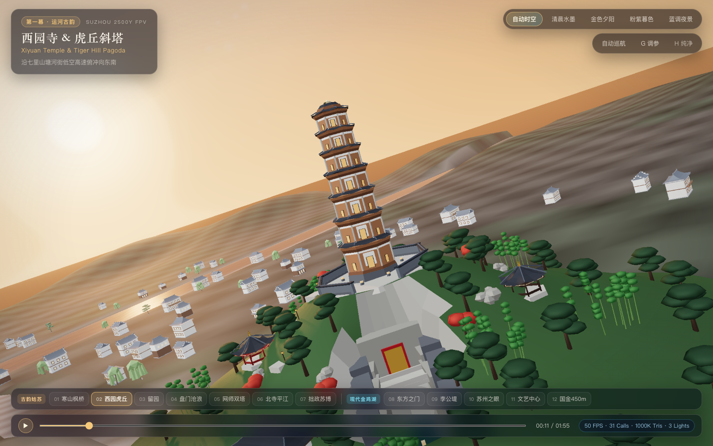
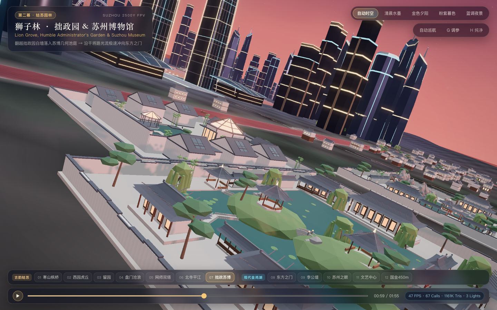
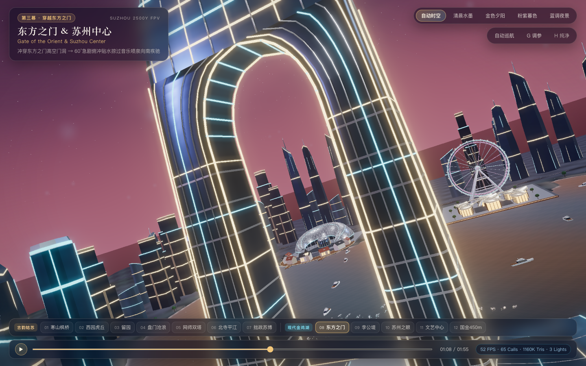
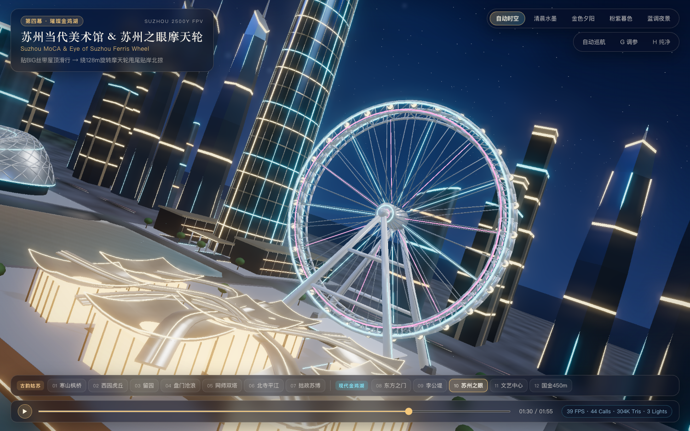
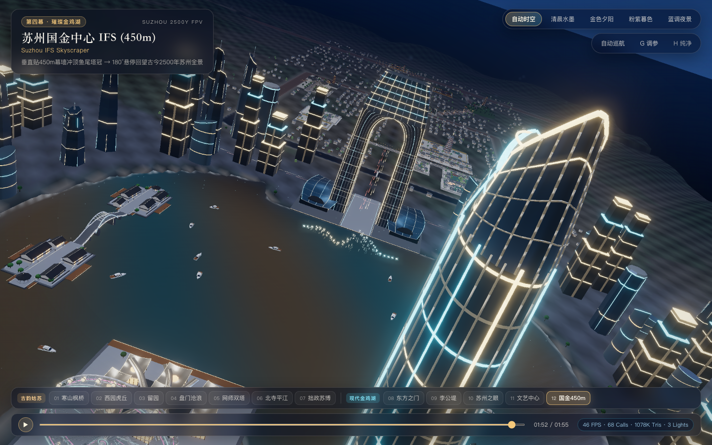
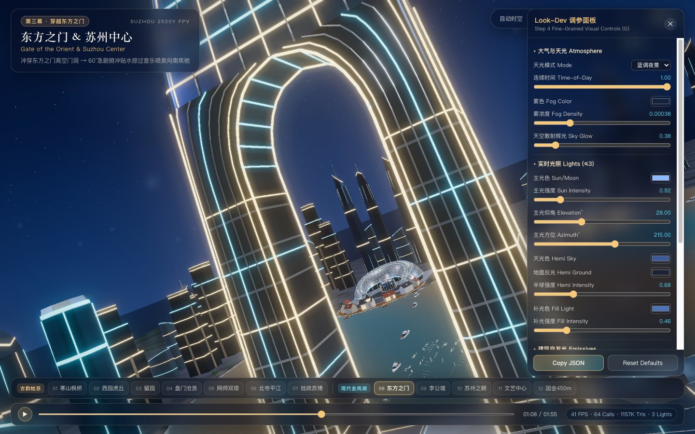

# 一镜飞越 2500 年苏州 · Suzhou 2500Y Drone Tour

> **Blender 5.2 + Three.js 实时 WebGL 3D 无人机一镜到底全景大片**  
> 从吴西大运河古刹与虎丘斜塔启程，飞越姑苏五大名园、双塔、北寺塔、平江水巷与贝聿铭苏州博物馆，穿破 301.8m 东方之门高空拱门，一路掠过李公堤、苏州当代美术馆、128m 旋转苏州之眼摩天轮、月牙文化艺术中心，最终沿 450m 苏州国金中心 IFS 垂直冲顶，180° 回望古今 2500 年苏州全城天际线。

- **🌐 在线 3D 交互体验（GitHub Pages）**：https://kingbright.github.io/suzhou-2500y-drone-tour/
- **🎬 完整 720p 30fps 实机渲染大片（MP4）**：[点击下载 / 观看 `suzhou-2500y-drone-tour-720p.mp4`](https://github.com/KingBright/suzhou-2500y-drone-tour/releases/download/v1.0.0/suzhou-2500y-drone-tour-720p.mp4)

---

## 视觉预览（实机 3D 渲染截图）

| 第一幕 · 西园寺 & 虎丘斜塔（金色夕阳） | 第二幕 · 拙政园 & 苏州博物馆（粉紫暮色） |
| :---: | :---: |
|  |  |

| 第三幕 · 穿飞 301.8m 东方之门拱门 | 第四幕 · 苏州当代美术馆 & 128m 苏州之眼摩天轮 |
| :---: | :---: |
|  |  |

| 压轴 · 450m 苏州 IFS 回望全城 2500 年夜景 | Step 4 · 实时 Look-Dev 精细调参面板（按 `G`） |
| :---: | :---: |
|  |  |

---

## 核心特色

1. **12 站全城古今一镜到底（西 → 中 → 东）**：
   - **第一幕 · 吴西古刹与斜塔**：`01 寒山寺 & 枫桥` → `02 西园寺 & 虎丘斜塔 (47.7m)`
   - **第二幕 · 姑苏名园与古塔水巷**：`03 留园` → `04 盘门三景 (瑞光塔/吴门桥) & 沧浪亭` → `05 网师园 & 苏州双塔` → `06 北寺塔 (76m) & 平江路水巷` → `07 狮子林 · 拙政园 & 苏州博物馆`
   - **第三幕 · 穿越时空之门**：沿干将路光流高速冲刺，实穿 `08 东方之门 (301.8m)` 230m 高空拱门，60° 俯冲掠过金鸡湖音乐喷泉
   - **第四幕 · 现代金鸡湖天际线**：`09 李公堤 (穿拱桥)` → `10 苏州当代美术馆 & 苏州之眼摩天轮 (128m 实时旋转)` → `11 苏州文化艺术中心 (月牙鸟巢) & 月光码头` → `12 苏州国金中心 IFS (450m 垂直冲顶回望)`
2. **电影级高速掠过转场（Speed-Ramp Swoop）**：双 `CatmullRomCurve3` 样条轨道（位置 + 注视点分离），地标处优雅慢速环绕、景点间爆发加速，自动联动 **Dynamic FOV（`46° → 82°`）+ 机身滚转（Roll `±22°`）+ 径向速度流光**。
3. **5 模式动态天光平滑切换**：
   - `自动时空`（默认随航线从西向东渐变：金色夕阳 → 粉紫暮色 → 蓝调璀璨夜景）
   - 随时一键切换 `清晨水墨` / `金色夕阳` / `粉紫暮色` / `蓝调夜景`，全城 4 通道建筑自发光（暖金灯笼/古塔檐灯/现代青蓝/霓虹点缀）实时联动。
4. **硬核 WebGL 性能优化**：
   - 全部 17 个 Blender 5.2 导出 `.glb` 总计仅 **`15.09 MB`**
   - 严格保持 **实时动态光源 = `3` 盏**（零 `PointLight` 掉帧陷阱）
   - 顶点色分区静态合批 + 城市基底 `InstancedMesh`，全程 **Draw Calls 仅 `25 ~ 71`**，浏览器稳跑 **45–60 FPS**！

---

## 交互与快捷键

| 按键 / 控件 | 功能说明 |
| :--- | :--- |
| 顶部右侧 5 档按钮 | 实时切换 `自动时空 / 清晨水墨 / 金色夕阳 / 粉紫暮色 / 蓝调夜景` |
| 底部 12 站导航条 / 数字键 `1`-`9`, `0`, `-`, `=` | 一键飞跃直达任意景点 |
| `Space` | 播放 / 暂停无人机巡航 |
| `F` 或右上角按钮 | 切换 **自动巡航 / 自由飞行模式**（`WASD / Q / E` + 鼠标拖拽自由飞越全城） |
| `G` | 展开 / 收起 **Look-Dev 精细调参面板**（25 项滑块 + `Copy JSON` + `Reset Defaults`） |
| `H` | 一键隐藏 / 恢复 **全部 UI**（纯净观影与录屏模式） |

---

## 开源复用：本项目背后的 Agent Skill（`blender-threejs-scene`）

本项目从 Step 0 路线调研、Step 1 参考图与 SVG 规划、Step 2 设计定稿、Step 3 多智能体并行 Blender 建模 + Three.js 引擎组装、Step 4 Look-Dev 面板，到 Step 5 视觉与性能复盘（3 轮 QA 把 Draw Calls 从 246 压降到 25–71），全部由本仓库一并开源的 Agent Skill **[`skills/blender-threejs-scene/`](skills/blender-threejs-scene/SKILL.md)** 驱动完成：

- [SKILL.md](skills/blender-threejs-scene/SKILL.md) — 6 阶段带门禁（Gate）的端到端 3D 生产主流程
- [references/prompts.md](skills/blender-threejs-scene/references/prompts.md) — Step 0 ~ Step 5 实战提示词模板库（含 `/grill-me`、`/swarm` 异构模型路由、Look-Dev 面板与视频复盘）
- [references/performance-and-lookdev.md](skills/blender-threejs-scene/references/performance-and-lookdev.md) — Blender → Three.js 导出契约、WebGL 30–60 FPS 性能红线（防光源爆炸）与 Look-Dev JSON 规范

### 一键安装该 Skill

```bash
# Antigravity 全局安装
git clone https://github.com/KingBright/suzhou-2500y-drone-tour.git
cp -r suzhou-2500y-drone-tour/skills/blender-threejs-scene ~/.gemini/config/skills/

# 或安装到任意项目的局部 .agents/skills/
mkdir -p .agents/skills && cp -r suzhou-2500y-drone-tour/skills/blender-threejs-scene .agents/skills/
```

---

## 本地运行与视频渲染

```bash
# 安装依赖并启动预览
cd web && npm install && npm run build && npx vite preview --port 4173

# 或使用一键脚本（预览 / 开发 / 重新构建 / 渲染视频）
./run.sh            # 构建并启动预览 http://127.0.0.1:4173
./run.sh dev        # 开发热更新模式
./run.sh video      # 调用 headless 渲染 720p 30fps H.264 MP4 大片
```

## 工程目录

- `skills/blender-threejs-scene/`：开源的端到端 Blender + Three.js 多智能体 3D 制作 Skill
- `blender/scripts/`：全部 17 个地标与铺城模块库的 Blender Python (`bpy`) 建模与导出脚本
- `web/`：Three.js + Vite + TypeScript WebGL 渲染引擎、着色器、无人机运镜与 UI
- `references/`：23 张真实建筑参考图与 3 张建筑级 SVG 航线/高程/剪影图
- `docs/`：`route-research.md`、`reference-plan.md`、`design-spec.md`、`aaa-upgrade-plan.md` 与精选截图
- `qa/`：自动化 36 机位视觉与性能验收脚本 `verify_suzhou.mjs` 及 30fps 视频渲染脚本 `render_video.mjs`

## License

[MIT License](LICENSE)
