# Step 0：「一镜飞越 2500 年苏州」全城古今 10 站无人机航线与工程架构方案

> 本文件遵循 `blender-threejs-scene` 技能的 **Step 0（地理/路线与可行性调研）** 产物规范。  
> 核心愿景：在一镜到底的 3D 无人机运镜中，从**吴西大运河古刹斜塔**启程，飞越**姑苏古城名园、古塔、水陆城门与平江水巷**，再穿过**东方之门**直入**现代金鸡湖摩登天际线**，用**高速掠过转场**将古今苏州最具代表性的建筑与风景全部无缝串联。

---

## 一、全城地理大势与「西 → 中 → 东」时间轴航线设计

苏州真实地理格局极其适合一镜到底——核心名胜天然沿 **西（大运河名刹）→ 中（护城河古城园林与古塔）→ 东（金鸡湖现代 CBD）** 排布，形成一条独一无二的**时空双轴线**：

```mermaid
flowchart LR
    subgraph ACT1["第一幕：吴西古刹与斜塔（金色夕阳）"]
        Z1["1. 寒山寺 & 枫桥<br/>古运河 · 普明宝塔 42m"]
        Z2["2. 虎丘塔 & 剑池山<br/>云岩斜塔 47.7m"]
    end

    subgraph ACT2["第二幕：姑苏古城 · 园林古塔水巷（暮色华灯）"]
        Z3["3. 留园 & 山塘河<br/>冠云峰 · 粉墙曲廊"]
        Z4["4. 盘门三景<br/>瑞光塔 53.6m · 吴门桥 · 水陆城门"]
        Z5["5. 北寺塔 & 平江路<br/>江南第一古塔 76m · 小桥流水"]
        Z6["6. 拙政园 & 苏州博物馆<br/>四大名园 · 贝聿铭几何白墙"]
    end

    subgraph ACT3["第三幕：穿越时空之门（干将路光流高速掠过）"]
        Z7["7. 东方之门 & 苏州中心<br/>301.8m 穿门俯冲 · 未来之翼"]
    end

    subgraph ACT4["第四幕：现代金鸡湖天际线（蓝调璀璨夜景）"]
        Z8["8. 李公堤 & 苏州之眼/当代美术馆<br/>长堤穿桥 · BIG丝带 · 128m摩天轮"]
        Z9["9. 苏州文化艺术中心 & 月光码头<br/>月牙鸟巢 · 滨水栈道"]
        Z10["10. 苏州国金中心 IFS<br/>450m 垂直冲顶 · 回望全城"]
    end

    Z1 -- "贴运河高速拉升" --> Z2
    Z2 -- "山塘河低空俯冲" --> Z3
    Z3 -- "护城河极速南掠" --> Z4
    Z4 -- "穿城拉升跃塔" --> Z5
    Z5 -- "贴黛瓦屋脊疾驰" --> Z6
    Z6 -- "干将路光流冲刺" --> Z7
    Z7 -- "穿230m门洞贴水俯冲" --> Z8
    Z8 -- "绕摩天轮贴岸急掠" --> Z9
    Z9 -- "掠月牙顶跃入CBD" --> Z10
```

---

## 二、10 大核心站点与高速掠过转场分镜表（全长约 100–120 秒）

| 站点 | 囊括地标与真实尺度 | 核心视觉符号（Blender Hero 精模重点） | 慢速观赏运镜（7–9s） | 衔接下一站的高速掠过转场（2.5–3.5s） |
| :---: | :--- | :--- | :--- | :--- |
| **01** | **寒山寺 & 枫桥** *古城西 · 大运河* | 枫桥单孔石拱、大运河乌篷船、寒山寺黄墙照壁、大雄宝殿、普明宝塔（42m 仿唐五层方塔） | 从枫桥水面低空推近黄墙与普明宝塔，夕阳余晖洒在古钟楼与河面上 | **【运河贴水拉升】** 贴着大运河水面极速向东北加速，越过古柳岸线急剧爬升 |
| **02** | **虎丘塔（云岩寺塔）** *古城西北 · 海涌山* | 海涌山翠绿山丘、剑池峡谷、千年七层八面砖塔（47.7m，明显倾斜角 2.34m） | 跃出树冠层，围绕倾斜的千年古塔做 210° 优雅仰拍环绕 | **【七里山塘俯冲】** 顺山势向下俯冲，沿山塘河与红灯笼古街屋檐极速向东南掠过 |
| **03** | **留园** *古城西北 · 阊门外* | 冠云峰太湖石、明瑟楼、涵碧山房水池、曲廊漏窗与层叠假山 | 低空滑入园内水庭，掠过曲折花窗与太湖石倒影，展现“移步换景”的园林精巧 | **【护城河外环疾驰】** 跃出粉墙，沿古城西侧护城河水面极速向南贴水滑行 |
| **04** | **盘门三景** *古城西南角* | 瑞光塔（53.6m 七级八面）、高拱吴门桥、全国唯一水陆并行古城门与城墙 | 从吴门桥高拱侧方切入，同框呈现“水陆城门 + 城墙 + 瑞光古塔”三景 | **【穿桥爬升跃城】** 低空高速穿过吴门桥桥洞 → 猛拉机头跃过古城墙，斜切古城中轴线 |
| **05** | **北寺塔（报恩寺塔）& 平江路** *古城中北 → 古城东* | 76m 江南第一古塔（九层八面重檐翘角）+ 平江路水陆并行古巷、小石桥、粉墙黛瓦灯笼 | 绕 76m 雄伟北寺塔顶俯瞰整座灰瓦古城（远方已隐约可见东方之门），随即降落平江路小桥流水 | **【黛瓦屋脊低空掠过】** 贴着平江路灯火水道高速穿行，猛然拉起擦过连片黑瓦屋脊向东北掠去 |
| **06** | **拙政园 & 苏州博物馆** *古城东北（一墙之隔）* | 拙政园荷塘、远香堂、小飞虹朱红廊桥 + 一墙之隔的贝聿铭**苏博**（现代几何粉墙黛瓦、片石假山、倒影池） | 先在拙政园亭台水榭低空舒缓滑翔，**翻越一堵白墙瞬间落入苏博几何光影水庭**——完成“古典 → 现代”美学转折！ | **【时空跃迁 · 干将路光流】** 从苏博菱形天窗极速拉升，沿干将路东西中轴化作高速流光飞越护城河，正前方 301.8m **东方之门**急速扑面而来！ |
| **07** | **东方之门（301.8m）& 苏州中心** *金鸡湖西岸（现代起点）* | 门字形双子塔（230m 高空拱门）、苏州中心巨型流线型“未来之翼”玻璃屋顶、湖滨音乐喷泉 | 逼近门楼中轴线短暂减速展现压迫感与幕墙灯光秀，随即提速对准拱门中心 | **【穿门俯冲贴水】** 极速冲穿 230m 东方之门门洞 → 穿出瞬间 60° 急剧俯冲至金鸡湖面 6m，擦过音乐喷泉水柱向南疾驰！ |
| **08** | **李公堤 + 苏州当代美术馆 & 苏州之眼摩天轮** *金鸡湖南岸 → 湖东右岸* | 李公堤湖中长堤与现代拱桥 + 湖东右岸 BIG 丝带屋顶美术馆 + 128m 亚洲最大水上摩天轮（28 太空舱） | 低空穿李公堤拱桥纵深拉升 → 弹射切入湖东右岸，贴着丝带屋顶滑行并绕 128m 发光摩天轮半周仰拍 | **【绕轮甩尾急掠】** 沿摩天轮外圈加速甩尾，借离心力擦过湖岸栈道高速向北掠过 |
| **09** | **苏州文化艺术中心（“月牙鸟巢”）& 月光码头** *金鸡湖东北岸* | 保罗·安德鲁设计的银色编织月牙穹顶 + 欧式水岸栈桥灯火 | 沿月牙穹顶光滑弧线做高速侧飘（Orbit Drift），隔湖远眺灯火通明的东方之门 | **【掠顶冲入摩天峡谷】** 沿月牙边缘如跳台高速拉起滚转，穿入湖东 CBD 玻璃幕墙高楼群 |
| **10** | **苏州国际金融中心 IFS（450m）** *湖东 CBD 制高点（压轴终点）* | 450m 江苏第一高楼（“鲤鱼跳龙门”鱼尾塔冠）+ 湖东 CBD 超高层天际线 | **【垂直极速冲顶 → 全城大回望】** 贴着 450m 发光玻璃幕墙垂直极速拉升，冲破塔冠后悬停 180° 回望：东侧璀璨金鸡湖夜景与西侧绵延古城古塔灯火同框，2500 年苏州一镜收官！ | *（支持片尾高空云端俯冲回寒山寺形成无缝循环，或随时切换 10 站点直达 / 自由飞行模式）* |

> **可选扩展彩蛋（不影响主线复杂度）**：如需补充**狮子林 / 沧浪亭 / 寒山寺钟声 / 狮山大剧院**，可在 Step 1/2 中按偏好替换或作为背景地标锚点接入（例如沧浪亭临近盘门，狮子林紧邻拙政园/苏博，几乎零额外路径成本）。

---

## 三、把 10 站全城古今装进浏览器且稳跑 45–60 FPS 的核心工程策略

把 14 公里跨度的 10 大景点塞进同一个 Three.js 场景，如果硬铺 1:1 真实全城，一定会内存爆炸和掉帧。本方案采用 **4 项成熟工程技术**彻底解决：

### 1. 「1:1 建筑真实尺度 + 压缩城市走廊」空间折叠法
- **Hero 建筑严格保留真实相对尺度**（如寒山寺普明塔 42m、虎丘塔 47.7m、瑞光塔 53.6m、北寺塔 76m、苏州之眼 128m、东方之门 301.8m、苏州 IFS 450m），保证视觉比例震撼且真实。
- **景点之间的普通城区/湖面适度压缩**：将真实 14km 东西跨度优雅压缩至约 **`3200m × 1800m`** 的连贯 3D 沙盘世界，景点间距控制在 `200m–450m`。这样每段“高速掠过切换”刚好持续 **2.5–3.5 秒**，全程紧凑无尿点，同时避免 Z-buffer 远景精度闪烁。

### 2. 沿 X 轴实时联动的「2500 年天光渐变」（零额外光源开销）
随着无人机从西向东飞行，用同一套 **≤ 3 盏实时光源** 动态插值天空盒、太阳仰角、雾效与建筑自发光，零额外算力就能实现电影级时间流逝感：
- **西区（寒山寺 / 虎丘）**：温暖 **Golden Hour 夕阳金光**（太阳低角度暖橙，斜照黄墙与斜塔）。
- **中区（留园 / 盘门 / 北寺塔 / 平江 / 拙政园 / 苏博）**：柔美 **Dusk 粉紫暮色**（屋檐灯笼与古塔轮廓灯渐亮）。
- **东区（穿东方之门 → 金鸡湖）**：震撼 **Blue Hour 蓝调夜景**（深蓝天空 + 玻璃幕墙 Emissive 灯光秀 + 湖面霓虹倒影 + Selective Bloom）。

### 3. 全城性能红线与资产分层
- **10 个 Hero 站点独立导出 `.glb`**（Draco 压缩，单个 1.5–3MB），支持按距离 LOD 与视锥裁剪。
- **两大背景基底库全部 `THREE.InstancedMesh`**：
  - *古城基底*：5~6 种模块化粉墙黛瓦民居、垂柳/古松、石拱小桥、河岸红灯笼、乌篷船；
  - *现代基底*：6~8 种湖东/湖西 CBD 玻璃幕墙塔楼、现代行道树、滨水路灯、游船。
- **硬守红线**：实时动态光源 **≤ 3 盏**（全部灯笼、塔灯、摩天楼窗灯、摩天轮灯带一律走 **Emissive 材质 + Bloom**），Draw Calls 控制在 **< 160**。

### 4. 如何用 `/swarm` 高效交付（避免单次任务过载）
10 大古今地标一次性全部堆给单轮 Swarm 容易稀释细节质量，推荐采用 **「1 套总骨架 + 2 批次并行精建」**：
1. **先建全城骨架（Coordinator）**：落地 `world-layout.json` 10 站精准坐标、3200m 连续水系（大运河→护城河→金鸡湖）、10 站白模占位、完整 100 秒双样条无人机轨道 + 高速掠过相机系统 + 夕阳→蓝调天光渐变。此时就能在浏览器里完整“飞完 10 站全流程”检验运镜节奏！
2. **Swarm 批次 A（古韵姑苏 6 站，Neon 并行 + Carbon 视觉验收）**：并行精建 寒山寺&枫桥、虎丘塔、留园、盘门三景、北寺塔&平江路、拙政园&苏州博物馆 + 古城民居基底。
3. **Swarm 批次 B（现代金鸡湖 4 站，Neon 并行 + Carbon 视觉验收）**：并行精建 东方之门&苏州中心、李公堤+当代美术馆+苏州之眼、文化艺术中心&月光码头、苏州 IFS 450m + 湖岸 CBD 天际线。
4. **统一进入 Step 4（Look-Dev 调参面板）& Step 5（全片录屏复盘 + AAA 提帧升级）**。

---

## 四、Step 0 门禁确认清单

在进入 **Step 1（拉取 10 站真实参考图 + 绘制全城航线总览 SVG、高程/天光剖面 SVG 与精确世界坐标规划）** 前，请确认以下 3 点：

1. **10 站清单是否完整、顺序是否满意**？  
   `寒山寺&枫桥 → 虎丘塔 → 留园 → 盘门三景(瑞光塔/吴门桥) → 北寺塔&平江路 → 拙政园&苏州博物馆 → 东方之门&苏州中心 → 李公堤+当代美术馆&苏州之眼 → 文化艺术中心&月光码头 → 苏州IFS(450m)`  
   （如有还想加的寺庙/园林/古塔，比如**西园寺、双塔、沧浪亭、狮子林、网师园**，随时增补！）
2. **「夕阳（吴西古刹）→ 暮色（姑苏园林）→ 蓝调夜景（金鸡湖现代）」的动态天光渐变**，你喜欢这种随飞行时间推进的电影感吗？还是更希望全城统一某个固定时段？
3. **推进节奏**：你认可上面建议的「先飞通 10 站完整运镜骨架 → 再分两批 Swarm 把古建与现代地标分别做精」的工程策略吗？
